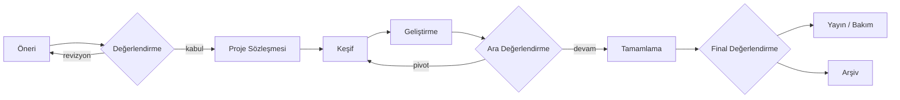

# IEEE Project Lab

**Gerçek problemler · Ölçülebilir sonuçlar · Özgün yaklaşımlar**

IEEE İKÇÜ TechOps bünyesinde öğrencilerin özgün mühendislik problemleri üzerinde çalıştığı proje geliştirme programının yönetişim deposu.

---

## Project Lab nedir?

Project Lab tek bir yazılım değildir. TechOps'a katılan öğrencilerin, iki-üç kişilik ekipler halinde **gerçekten çözülmesi gereken bir problem** üzerinde çalıştığı yapılandırılmış bir program.

Örneğin TechOps'a altı stajyer katıldığında herkesi aynı ürüne atamak yerine:

| Ekip | Odak | Çıktı türü |
| --- | --- | --- |
| 2 kişi | Digital Archive ve belge zekâsı | Ürün / sistem |
| 2 kişi | Machine Learning araştırması | Araştırma raporu + tekrarlanabilir kod |
| 2 kişi | Açık kaynak mühendislik aracı | Yayınlanmış açık kaynak paket |

Her projenin kendi GitHub deposu, teknik belgeleri, testleri ve düzenli sunumları olur.

## Temel ilkeler

1. **Problem önce gelir.** Her proje kimin, hangi durumda, neden zorlandığını kanıtla açıklar. "Bir model eğitip %95 accuracy aldık" tek başına sonuç değildir.
2. **Başarı ölçülebilir olmalıdır.** Proje başında bir *baseline*, bir hedef metrik ve bu metriğin nasıl ölçüleceği yazılır.
3. **Farkı açıkla.** Mevcut çözümler incelenir; projenin onlardan nasıl ayrıldığı (veya neden yeniden yapıldığı) belgelenir.
4. **IEEE Hub'a bağlı olmak zorunlu değildir.** Proje IEEE'ye, üniversiteye veya daha geniş mühendislik topluluğuna fayda sağlayabilir.
5. **Açık ve devredilebilir çalışırız.** Kod, belge ve kararlar bir sonraki ekibin devralabileceği şekilde tutulur.
6. **Etik ve veri güvenliği pazarlık konusu değildir.** Kişisel veri, KVKK ve araştırma etiği her aşamada gözetilir.

## Proje yaşam döngüsü

Ayrıntılar: [Yaşam döngüsü ve kapılar](docs/lifecycle.md)

## Bu depoda ne var?

| Belge | İçerik |
| --- | --- |
| [GOVERNANCE.md](GOVERNANCE.md) | Roller, karar yetkileri ve Değerlendirme Kurulu |
| [PROJECTS.md](PROJECTS.md) | Aktif, aday ve arşivlenmiş projeler |
| [docs/lifecycle.md](docs/lifecycle.md) | Aşamalar, kapı kriterleri ve çıktılar |
| [docs/evaluation-rubric.md](docs/evaluation-rubric.md) | Öneri ve sonuç değerlendirme ölçütleri |
| [docs/project-standards.md](docs/project-standards.md) | Her proje deposunun asgari standardı |
| [docs/research-integrity.md](docs/research-integrity.md) | Araştırma ve ML projeleri için bilimsel dürüstlük kuralları |
| [docs/cadence.md](docs/cadence.md) | Toplantı, rapor ve sunum ritmi |
| [docs/team-formation.md](docs/team-formation.md) | Ekip kurma, mentorluk ve katılım |
| [docs/ip-and-licensing.md](docs/ip-and-licensing.md) | Lisans, sahiplik, atıf ve yayın |
| [templates/](templates/) | Sözleşme, rapor, sunum ve proje README şablonları |

## Nasıl başlarım?

1. [Yaşam döngüsünü](docs/lifecycle.md) ve [değerlendirme ölçütlerini](docs/evaluation-rubric.md) oku.
2. [Proje önerisi](https://github.com/ieeetechops/project-lab/issues/new?template=project-proposal.yml) issue'su aç.
3. Değerlendirme Kurulu'nun geri bildirimine göre öneriyi netleştir.
4. Kabul edilen proje için [proje sözleşmesini](templates/project-charter.md) doldur ve proje deposunu [standartlara](docs/project-standards.md) göre oluştur.

## İlişkili depolar

- [ieeetechops/ieeetechops](https://github.com/ieeetechops/ieeetechops): TechOps genel yönetişimi, katkı ve güvenlik politikaları

> Bu depo kişisel veri, parola, erişim anahtarı veya gizli yapılandırma içermez. Güvenlik bildirimleri için [TechOps güvenlik politikasını](https://github.com/ieeetechops/ieeetechops/blob/main/SECURITY.md) kullan.
