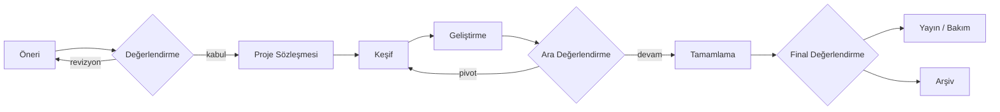

# IEEE Project Lab

IEEE İKÇÜ Teknik Operasyonlar ve Altyapı Dairesi Başkanlığı (TechOps) bünyesinde yürütülen öğrenci proje geliştirme programının yönetişim deposu.

---

## Project Lab nedir?

Project Lab, TechOps bünyesinde yürütülen öğrenci proje geliştirme programıdır. Programa katılan öğrenciler iki veya üç kişilik ekipler oluşturur ve [proje kataloğundan](catalog/README.md) seçtikleri ya da kendi önerdikleri bir mühendislik problemi üzerinde 14 haftalık bir dönem boyunca çalışır.

Projeler, çıktı türüne göre dört gruptan birinde yer alır:

| Proje türü | Beklenen çıktı |
| --- | --- |
| Ürün geliştirme | Kullanıma hazır uygulama, araç veya sistem |
| Deneysel araştırma | Tekrarlanabilir deney, veri kümesi ve teknik rapor |
| Kullanıcı araştırması | Kullanıcı çalışması, ölçüm sonuçları ve tasarım önerileri |
| Yaratıcı mühendislik | Çalışan prototip, algoritma karşılaştırması ve demo |

Her projenin ayrı bir GitHub deposu, teknik belgeleri, testleri ve dönem içinde düzenli sunumları bulunur.

## Temel ilkeler

1. **Tanımlı problem.** Her proje, ele aldığı problemi ve bu problemden etkilenen kullanıcıları kanıta dayalı olarak açıklar. Tek başına bir metrik değeri sonuç olarak kabul edilmez.
2. **Ölçülebilir hedef.** Proje başında bir başlangıç ölçümü (baseline), hedef metrik ve ölçüm yöntemi yazılır.
3. **Mevcut çalışmalarla karşılaştırma.** Benzer çözümler incelenir; projenin bunlardan farkı veya yeniden geliştirilme gerekçesi belgelenir.
4. **Kapsam serbestliği.** Projelerin IEEE İKÇÜ'nün iç sistemlerine bağlı olması gerekmez; kola, üniversiteye veya açık kaynak topluluğuna katkı sağlayan projeler kabul edilir.
5. **Açıklık ve devredilebilirlik.** Kod, belgeler ve kararlar bir sonraki ekibin devralabileceği şekilde tutulur.
6. **Etik ve veri güvenliği.** Kişisel verilerin korunması, KVKK ve araştırma etiği her aşamada gözetilir.

## Proje yaşam döngüsü

Ayrıntılar: [Yaşam döngüsü ve kapılar](docs/lifecycle.md)

## Bu depoda ne var?

| Belge | İçerik |
| --- | --- |
| [GOVERNANCE.md](GOVERNANCE.md) | Roller, karar yetkileri ve Değerlendirme Kurulu |
| [catalog/](catalog/README.md) | 8 alanda 32 projelik katalog; her proje sade dille ve teknik terimleri açıklanarak anlatılır |
| [catalog/glossary.md](catalog/glossary.md) | Katalogda geçen genel terimlerin sözlüğü |
| [PROJECTS.md](PROJECTS.md) | Aktif, aday ve arşivlenmiş projeler |
| [docs/lifecycle.md](docs/lifecycle.md) | Aşamalar, kapı kriterleri ve çıktılar |
| [docs/evaluation-rubric.md](docs/evaluation-rubric.md) | Öneri ve sonuç değerlendirme ölçütleri |
| [docs/project-standards.md](docs/project-standards.md) | Her proje deposunun asgari standardı |
| [docs/research-integrity.md](docs/research-integrity.md) | Araştırma ve ML projeleri için bilimsel dürüstlük kuralları |
| [docs/cadence.md](docs/cadence.md) | Toplantı, rapor ve sunum ritmi |
| [docs/team-formation.md](docs/team-formation.md) | Ekip kurma, mentorluk ve katılım |
| [docs/ip-and-licensing.md](docs/ip-and-licensing.md) | Lisans, sahiplik, atıf ve yayın |
| [templates/](templates/) | Sözleşme, rapor, sunum ve proje README şablonları |

## Nasıl başlarım?

1. [Proje kataloğuna](catalog/README.md) göz at, ilgini çeken 2–3 projenin sayfasını oku.
2. [Yaşam döngüsünü](docs/lifecycle.md) ve [değerlendirme ölçütlerini](docs/evaluation-rubric.md) oku.
3. Seçtiğin proje için [Project Brief](templates/project-brief.md) doldur ve [proje önerisi](https://github.com/ieeetechops/project-lab/issues/new?template=project-proposal.yml) issue'su aç.
4. Değerlendirme Kurulu'nun geri bildirimine göre öneriyi netleştir.
5. Kabul edilen proje için [proje sözleşmesini](templates/project-charter.md) doldur ve proje deposunu [standartlara](docs/project-standards.md) göre oluştur.

## İlişkili depolar

- [ieeetechops/ieeetechops](https://github.com/ieeetechops/ieeetechops): TechOps genel yönetişimi, katkı ve güvenlik politikaları

> Bu depo kişisel veri, parola, erişim anahtarı veya gizli yapılandırma içermez. Güvenlik bildirimleri için [TechOps güvenlik politikasını](https://github.com/ieeetechops/ieeetechops/blob/main/SECURITY.md) kullan.
