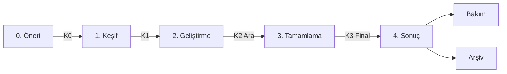

# Proje Yaşam Döngüsü

Her Project Lab projesi aynı aşamalardan geçer. Aşamalar arasındaki geçişler **kapılarla** (gate) korunur: bir sonraki aşamaya geçmek için o kapının çıktıları tamamlanmış olmalıdır.

Tipik bir dönem **14 hafta** sürer. Süreler rehberdir; proje sözleşmesinde farklı takvim belirlenebilir.

## 0. Öneri — Hafta 0

**Amaç:** Problemin gerçek, ölçülebilir ve dönem içinde ele alınabilir olduğunu göstermek.

Çıktılar:
- [Proje önerisi issue'su](../.github/ISSUE_TEMPLATE/project-proposal.yml)
- Problem kanıtı: kullanıcı görüşmesi, veri, şikâyet kaydı, literatür veya mevcut iş akışı gözlemi
- Mevcut çözümlerin kısa listesi

**Kapı K0 — Kabul:** Değerlendirme Kurulu öneriyi [ölçütlere](evaluation-rubric.md) göre puanlar. Kabul edilen proje için [proje sözleşmesi](../templates/project-charter.md) imzalanır (PR ile proje deposuna eklenir).

## 1. Keşif — Hafta 1–3

**Amaç:** Problemi derinleştirmek, baseline'ı ölçmek, yaklaşımı seçmek.

Çıktılar:
- `docs/problem.md`: problem tanımı, paydaşlar, kapsam dışı kalanlar
- `docs/related-work.md`: mevcut çözümler/literatür ve farkımız
- **Baseline ölçümü:** bugünkü durumun veya en basit çözümün sayısal sonucu
- İlk ADR: seçilen yaklaşım ve reddedilen alternatifler
- Proje deposu [standartlara](project-standards.md) uygun iskeletle hazır

**Kapı K1 — Yaklaşım onayı (mentor):** Baseline ölçülmüş, hedef metrik ve ölçüm yöntemi net, yaklaşım gerekçeli.

## 2. Geliştirme — Hafta 4–8

**Amaç:** Çalışan ilk sürümü üretmek ve hedef metriğe karşı ölçmek.

Çıktılar:
- Testleri ve CI'ı olan çalışan sürüm (prototip, model, araç)
- Deney kayıtları ([deney günlüğü şablonu](../templates/experiment-log.md))
- İki haftada bir demo

**Kapı K2 — Ara değerlendirme (Kurul), Hafta 8:** [Ara değerlendirme şablonuyla](../templates/midterm-review.md) sunum yapılır. Olası kararlar:

| Karar | Ne zaman |
| --- | --- |
| **Devam** | Baseline'a karşı anlamlı ilerleme veya net bir yol var |
| **Kapsam daralt** | Hedef doğru ama dönem içinde tamamı gerçekçi değil |
| **Pivot** | Problem veya yöntem varsayımı yanlış çıktı; Keşif'e dönülür |
| **Durdur** | Problem gerçek değil, veri/erişim yok veya ekip devam edemiyor |

## 3. Tamamlama — Hafta 9–13

**Amaç:** Sonucu sağlamlaştırmak, belgelemek ve başkasının kullanabileceği hale getirmek.

Çıktılar:
- Kararlı sürüm (etiketli release)
- Kullanım ve kurulum belgeleri
- Değerlendirme sonuçları: baseline vs. sonuç, hata analizi, sınırlılıklar
- Devir notları: açık işler, bilinen hatalar, erişimler

## 4. Sonuç — Hafta 14

**Kapı K3 — Final değerlendirme (Kurul):** [Final rapor](../templates/final-report.md) ve herkese açık sunum. Kurul projenin sonraki yolunu belirler:

| Sonraki durum | Anlamı |
| --- | --- |
| **Bakım** | Kullanılıyor; bir sorumlu bakımı üstlenir, PROJECTS.md'de aktif kalır |
| **Sonraki dönem devam** | Yeni ekip veya aynı ekip ikinci faza geçer; yeni sözleşme yazılır |
| **Yayın / dış katkı** | Makale, konferans, yarışma veya upstream açık kaynak katkısına dönüşür |
| **Arşiv** | Depo arşivlenir; final raporu ve öğrenilenler korunur |

## Erken kapanış

Durdurulan projeler de bir **kapanış raporu** (final rapor şablonunun kısa hali) yazar: ne denendi, neden durduruldu, sonraki ekip neyi bilmeli. Bu rapor başarısızlık değil, programın hafızasıdır.
