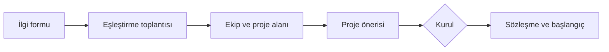

# Ekip Kurma ve Katılım

## Katılım

- Project Lab, TechOps'a stajyer veya gönüllü olarak katılan öğrencilere açıktır.
- Dönem başında katılımcılar kısa bir ilgi formu doldurur: ilgi alanları, mevcut beceriler, öğrenmek istedikleri, haftalık ayırabilecekleri süre.
- Beklenen asgari katkı: **haftada 6–8 saat**, haftalık rapor ve demolara katılım.

## Ekip yapısı

- Ekipler **2–3 kişiden** oluşur. Tek kişilik proje yalnızca Program Lead onayıyla açılır.
- Her ekipte bir **Proje Sahibi** seçilir; sahiplik dönem ortasında devredilebilir.
- Her ekibe bir **mentor** atanır. Bir mentor en fazla 2 ekip yürütür.
- Ekipler mümkün olduğunca farklı becerileri bir araya getirir (ör. bir backend + bir veri; bir araştırma + bir yazılım).

## Atama süreci

1. Program Lead ilgi formlarına göre ekip ve aday alan önerir.
2. Ekipler ilk haftada kendi proje önerilerini yazar; aday alan listesi ([PROJECTS.md](../PROJECTS.md)) yol gösterir ama zorunlu değildir.
3. Ekip içi uyumsuzlukta ilk 3 hafta içinde değişiklik yapılabilir.

## Mentor sorumlulukları

- Haftalık 30 dakikalık görüşme
- Haftalık raporları okuyup en az bir somut geri bildirim vermek
- Kritik PR'ları incelemek
- Proje 🟡 veya 🔴 durumuna geçtiğinde Program Lead'i bilgilendirmek
- Kendi ekibinin değerlendirmesinde oy kullanmamak

## Ayrılma ve devir

- Dönem ortasında ayrılan üye, ayrılmadan önce elindeki işi issue'larda devreder ve Program Lead'e bildirir.
- Ekip tek kişiye düşerse Kurul kapsam daraltma veya ekipler arası birleşme kararı verir.

## Tanınma

Programı tamamlayan katılımcılar:
- Final raporunda katkılarıyla birlikte listelenir.
- IEEE İKÇÜ katılım/başarı belgesi alır (kriterler dönem başında duyurulur).
- Projeyi portföylerinde ve CV'lerinde kullanabilir (bkz. [lisans ve sahiplik](ip-and-licensing.md)).
